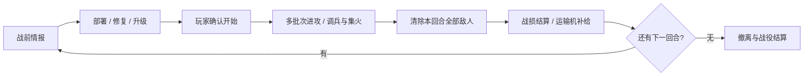

# 《星河战队：孤垒》游戏策划

> 版本：v0.3（含历史草案与实施修订）· 2026-11-01\
> 类型：俯视 2D 基地防御 / 战术布防 / 波次生存\
> 产品目标：一局战役包含 10–15 回合，首版以 12 回合为基准；先实现前三回合验证玩法。\
> 文档性质：第 1–16 节保留历史草案和原型修订；**第 17 节记录已实施的十回合版本，当前规则以该节及 `starship/README.md` 为准。**

## 1. 核心定位

玩家是一座孤立前哨基地的指挥官。虫群从四周涌来，步兵沿墙射击，机枪压制正面，炮塔阻止重装虫破墙，防空导弹拦截越墙飞虫，地雷给薄弱防线争取时间。每轮战斗之后，运输机投下补给；玩家用有限资源修复损失、调整部署，迎接下一次进攻。

电影第一部基地防御场景带来的主要体验，转化为三个可操作的决策：

1. **守哪边**：四面都不能放空，但主攻方向值得集中投资。
2. **用什么守**：对地火力、反重甲、对空和一次性爆发各有用途。
3. **为下一轮留下什么**：眼前多买一座炮塔，还是修墙、保留机动步兵、存下补给？

战斗自动进行，玩家负责布防、调兵和集火。重点是建立、检验、修正防御方案。

| 项目 | 设计目标 |
|---|---|
| 工作名称 | 星河战队：孤垒 |
| 建议代码目录 | `starship/` |
| 单局内容 | 同一基地，连续 12 回合；数据结构支持 10–15 回合 |
| 原型内容 | 同一套完整规则下的前 3 回合 |
| 时长目标 | 原型 6–9 分钟；12 回合战役约 25–35 分钟 |
| 操作平台 | 桌面鼠标键盘、横屏 iPad 点选 |
| 胜利 | 完成全部回合、指挥中心仍然存活，运输舰抵达并接走守军 |
| 失败 | 指挥中心生命归零；某面墙失守、损失部队均可继续战斗 |
| 难度来源 | 方向分配、兵种组合、有限预算、持久损耗、战斗中的调兵时机 |

## 2. 仓库现状与可借鉴的经验

2026-11-01 已执行 `git fetch origin`，本地 `main` 与 `origin/main` 一致，最新提交为 `2305d9d`。仓库目前有 9 个主页项目入口、146 个跟踪文件、68 次提交。

- `darkzone/` 已完成俯视 Canvas 游戏：配置集中在 `js/config.js`，关卡在 `js/level.js`，包含几何、碰撞、视野、Web Audio、交互 UI 和检查点。
- `towerclash/` 已有塔防单位、自动索敌、弹道、范围伤害、结构耐久、固定时间步与 iPad 输入适配。
- `odyssey/`、`airline/` 的经验适合用于版本化存档、暂停菜单、章节/回合重试和结算。
- 各游戏通过独立目录、原生 ES Modules 与静态 HTML 发布，没有统一打包流程。

新游戏沿用这个部署方式，借鉴代码结构和纯函数。四面围攻、城墙缺口、空地分层、回合补给和跨回合损耗需要专门设计。`towerclash` 的三路横向索敌与 `darkzone` 的单角色视野不直接适用于本游戏。

本次只新增策划文档。游戏入口、首页卡片和版本钩子的接入属于后续实现阶段。

## 3. 三回合原型与完整战役的关系

**前三回合是完整战役的开头。** 第三回合验证成功后，后续回合应通过配置、敌人组合与节奏扩展，而不是重做经济或战斗系统。

| 阶段 | 验证内容 | 暂不加入的复杂度 |
|---|---|---|
| 原型 1–3 回合 | 四面部署、全部五类装备、空地目标、破墙、调兵、两次中场补给 | 科技树、随机事件、多地图 |
| 扩充至 6 回合 | 酸液虫、持续损耗、第一档强化、变化的主攻方向 | 更多资源种类 |
| 完整 12 回合 | 混合虫群、掘进威胁、攻城虫、第二档强化、最终撤离 | 无尽模式、多人模式 |
| 可选扩至 15 回合 | 新的组合与压力节奏、额外战役段 | 单纯给全部敌人加血 |

原型第三回合结束显示“原型防守完成”，测试补给入账和结算；完整战役第三回合结束正常进入第四回合准备阶段。统一使用关卡配置的回合数组长度决定终局，不能在逻辑中写死 `round === 3`。

## 4. 战场与四面布防

### 4.1 一眼看清全局

采用略有高度表现的俯视 2D 画面：沙漠或岩地中央是一座方形前哨，四面围墙，中央指挥中心与撤离停机坪。

```text
                         北侧虫群
                            ↓
                地雷带 / 暴露接近区
          ┌────── 北墙：步兵、重武器 ──────┐
          │                               │
 西侧 →   西墙   防空位    指挥中心   防空位  东墙   ← 东侧
          │             / 停机坪           │
          │          内环调兵通道           │
          └────── 南墙：步兵、重武器 ──────┘
                地雷带 / 暴露接近区
                            ↑
                         南侧虫群
```

建议世界尺寸 120 × 90 个游戏距离单位，基地外沿约 44 × 34。四边地形略有差异：北侧接近路宽、南侧有弯折、东侧岩块分流、西侧开阔。每个方向至少有两条局部接近线，地面虫在所属扇区内寻找可攻击的墙段，避免所有虫排成一列。

地图和围墙全程可见。接近区内显示敌人，远端用尘土、雷达箭头与波次预告表现来袭规模。首版不沿用 Darkzone 的黑色探索迷雾：玩家需要同时判断四面的火力分配。

### 4.2 部署位置

| 区域 | 容量 | 用途 |
|---|---:|---|
| 每面墙的步兵位 | 3 组，共 12 组 | 班组驻守；空位允许相邻部队调入 |
| 每面墙的重武器基座 | 2 个，共 8 个 | 机枪座与炮塔共用，形成取舍 |
| 基地内的防空平台 | 4 个 | 放置防空导弹，圆形覆盖、可交叉支援 |
| 每面墙外的地雷位 | 4 个，共 16 个 | 一次性消耗，显示触发与爆炸范围 |
| 基地内环 | 固定道路 | 步兵真实移动、预备队回防、墙破后的最后防线 |

地雷位分为前后两排，每排两位；重武器不能占地雷位，步兵不能叠放在同一位置。首次拖入或点选时显示可用位置、覆盖范围和价格，不使用隐藏占地规则。

**四方可部署从第一回合就成立**；第一回合只是主攻方向更少，不能有任意一边完全没有来袭。

### 4.3 城墙与突破

- 四面墙各有独立耐久，初始均为 900；画面将其分为若干视觉段，首版按整面墙统一结算。
- 地面虫不能穿过完好的墙。它们攻击接近位置的墙面，墙毁后出现明确缺口，再通过缺口进入基地。
- 一面墙归零只打开该面的预设缺口，不把整圈碰撞移除；废墟不可作为廉价绕墙捷径。
- 完好墙后的高架枪位能向本面外侧射击。地面单位在基地内部射击时，完整墙体和指挥中心仍挡住直射弹。
- 飞虫可以越墙；炮弹按抛物线处理。地雷爆炸受完整墙体遮挡，不能隔墙伤害基地内的虫。
- 步兵可通过固定内侧楼梯撤下墙，失守前优先给出“撤回内环”按钮。墙毁时驻守步兵受一次冲击伤害，幸存者撤到墙后，不随墙自动全部死亡。
- 指挥中心初始耐久 1,400；地面虫进入基地后会攻击挡路守军和指挥中心，飞虫优先骚扰暴露的防御单位。

## 5. 每回合的循环



### 5.1 准备阶段

- 时间暂停，无强制倒计时；显示下一回合主攻方向、已识别虫种和大致规模。
- 购买、部署、修墙、升级；幸存步兵可以免费重排，固定设施可以免费搬迁到兼容空位。
- 刚买且尚未进入战斗的部署可全额撤销；已参与战斗的设施拆除按原始购买价的 40% 回收，排除升级费用。
- 购买升级、付费修复前显示结果和总价；开战前可撤销本次准备阶段的修改，整体回滚该次修改的消耗与恢复量。
- “开始下一回合”按钮旁显示四面火力、破损墙体、是否缺少对空，不阻止玩家采用自选方案。

### 5.2 战斗阶段

- 所有武器自动索敌开火，玩家可对某只虫设置优先集火、选择班组调往其他墙面或内环。
- 可暂停战术画面并下达命令，恢复后执行；暂停时不推进敌人、炮弹、装填和调兵。
- 步兵移动期间不能射击，必须沿内环与楼梯真实行走，不能瞬间跨边。正在被虫贴身攻击的部队也可能撤离失败。
- 固定武器不能搬迁、出售或临时新建。战斗中的资源不自动生产，也不能无限召唤增援。
- 地雷只能在准备阶段布设。首版不加入即时投弹或付费轰炸，先验证玩家布防本身的效果。
- 默认 1 倍速；原型可提供 2 倍速用于测试，进入破墙/核心危险状态时自动回到 1 倍速。

### 5.3 补给结算

必须满足“本回合出怪计划执行完毕、待生成队列为空、存活敌人为零”才结束普通回合。不能只在时间到达时把剩余敌人删除。

结算显示本回合资源、损失、各方向破墙情况、地雷消耗及各单位输出，再一次性入账补给。最后一回合也有任务补给/奖励结算，但进入撤离，不再开启无意义的购买阶段。

## 6. 资源与长期经济

### 6.1 一个资源，多个用途

首版只使用一种资源：**军需点**。它用于招募班组、购买武器、地雷、升级和修复。枪弹采用自动装填，不另设可耗尽弹药、人口上限或电力资源；装填间隔本身构成火力节奏。

| 项目 | 初始规则 |
|---|---|
| 开局军需点 | 620 |
| 第 r 回合结束的固定补给 | `260 + 40 × r`；第 1/2/3 回合为 300/340/380 |
| 资源结转 | 剩余点数全部进入下一回合，无利息、无过期 |
| 击杀资源 | 无；避免守得好就越来越富、守得差无法翻身 |
| 额外战果奖励 | 完整版可加，最多为当回合固定补给的 10%；原型不做 |
| 自动维护 | 每回合后幸存单位恢复最大生命的 20%，存活墙体恢复 80；不能复活已毁单位或墙 |
| 墙体修复 | 20 点恢复指定墙体 200 耐久，不超过上限 |
| 破墙重建 | 120 点恢复该面墙至 600 耐久，再按普通修复补满 |
| 单位修理 | 支付原始造价的 25%（向上取整），恢复最大生命的 50%，不超过上限 |
| 指挥中心修理 | 40 点恢复 200 耐久；每个准备阶段最多购买一次 |

固定补给无须保护运输机或完成额外任务才能获得；投送动画不会扣掉下一轮部署时间。后续即使增加“保护补给机”，也应把它作为额外奖励而非翻盘必需资源。

12 回合战役在进入最终回合前的固定总预算为 `620 + Σ(260 + 40r), r=1..11 = 6,120` 点。它必须同时承担新增火力、维护、升级和地雷消耗。最终价格和敌人总量以这个总盘子一起调整。

### 6.2 哪些损耗保留

- 幸存单位、等级、剩余生命、城墙缺口、指挥中心损伤、剩余军需点与未触发地雷全部保留。
- 已触发地雷不会随回合自动再生；被摧毁装备需要重新购买。
- 自动维护是有限恢复，给受挫玩家留下恢复空间；它不会把每一轮都重置为满状态。
- 每轮都有确定的补给，玩家可选择“这一轮先靠残墙扛住，多攒一点重建费”。

## 7. 五类部署单位

以下数值均为一级单位基准；距离使用统一游戏单位，伤害率不含换目标与移动损失。

| 单位 | 价格 | 生命 | 射程 / 射界 | 火力基准 | 核心作用与短板 |
|---|---:|---:|---|---|---|
| 步兵班组（3 人表现） | 70 | 240 | 对地 18，对空 14；360° | 对地合计 18 伤害/秒；对空为 50% | 最灵活、可调兵、可守内环；打重甲吃力，移动停止射击 |
| 机枪座 | 130 | 360 | 22；朝外 120° | 对地 36 伤害/秒；对空为 50% | 持续清理普通虫、支援近空；射界固定，重甲抗性明显 |
| 炮塔 | 220 | 420 | 30；朝外 150° | 每 2.8 秒一发，110 爆炸伤害，半径 2.5 | 处理重甲、集中虫群；换向和装填慢，不打空中 |
| 防空导弹 | 180 | 280 | 32；360° | 每 3.5 秒一枚，140 对空伤害 | 跨方向支援、优先拦截飞虫；不攻击地面 |
| 近炸地雷 | 20 | 一次性 | 地面触发半径 1，爆炸半径 3 | 180 爆炸伤害，轻型虫短暂硬直 0.8 秒 | 补薄弱方向、打断成群突进；用后消失，不能打飞虫 |

班组在首版按一个单位结算生命与输出，三个士兵用于视觉表现；不引入逐个士兵补员的第二套经济。装填、转向延迟和射界要在 UI 上可见，不能只有数字 DPS。

### 7.1 兵种配合

- **步兵 + 机枪**：处理一般虫潮，步兵负责临时增援。
- **机枪 + 炮塔**：机枪清轻型虫，炮塔优先重甲，避免炮弹都浪费在单只小虫上。
- **防空 + 地面火力**：步兵和机枪可应急对空，但长期混合进攻需要专职防空，不能全场只堆机枪。
- **地雷 + 弱侧驻军**：地雷先削弱虫群，让少量步兵有机会守住侧翼；不能靠单颗雷稳定清掉整轮。
- **墙体 + 内环预备队**：投入修墙是在买火力时间；保留预备队是在为突破后的局面留后手。

地雷不误伤友军；同一爆炸不能无条件连锁引爆整排地雷。最近一颗引爆后，其余地雷按自身触发规则判断，未触发的仍然保留。

### 7.2 目标优先级

| 单位 | 默认优先级 |
|---|---|
| 步兵 | 正在攻击自己的虫 → 已入基地的虫 → 距离防线最近的虫 |
| 机枪 | 射界内最接近防线的轻型地面虫 → 其他地面虫 → 近空目标 |
| 炮塔 | 重甲/攻城虫 → 密集地面虫群 → 单体轻型虫 |
| 防空 | 已越墙、接近步兵或导弹平台的飞虫 → 其他飞虫 |

玩家集火命令只改变合法目标的优先级，不扩大射程、不让炮塔打飞虫。导弹与炮弹采用在途伤害预估，减少多座武器对同一低血目标过度开火。

### 7.3 完整版强化

第四回合开放二级强化，第八回合开放三级；原型全部一级。

- 二级花费原始造价的 60%，三级花费 80%，均向上取整；伤害和最大生命分别为一级的 1.25 / 1.50 倍，装填和射程不变。
- 升级保持生命比例，不等同于免费满血修理。
- 升级适合基座快满时提高单位密度；继续买新单位、升级、修复各有机会成本。
- 地雷保持一次性装备，首版及标准 12 回合不做地雷科技树。

## 8. 虫群与克制关系

| 虫种 | 首次出现 | 初始生命 / 速度 | 行为与威胁 | 主要应对 |
|---|---:|---|---|---|
| 战士虫 | 1 | 75 / 2.2 | 成群接近并攻击墙面；单体墙伤较低 | 步兵、机枪 |
| 奔袭虫 | 1 | 40 / 3.6 | 少量突进侧翼，抓火力薄弱的方向 | 侧翼步兵、地雷、提前调兵 |
| 飞翼虫 | 2 | 95 / 3.1 | 越过城墙骚扰守军、防空和指挥中心 | 防空导弹、少量近空支援 |
| 重甲虫 | 3 | 650 / 1.2 | 子弹伤害 ×0.35，爆炸伤害 ×1；对墙伤害高 | 炮塔、地雷、集火 |
| 喷酸虫 | 5 | 180 / 1.7 | 在墙外射程 20 处停下，标记落点 1.5 秒后攻击固定阵地 | 炮塔射程、调走被标记步兵 |
| 掘进虫 | 9 | 待前 6 回合验证后定 | 从墙外近距离预告点出现，缩短接近时间 | 预备队、保留内层地雷 |
| 巨型攻城虫 | 10 | 分阶段耐久 | 大型目标，压迫单面并伴随护卫虫，不随机瞬杀整面墙 | 炮塔集中、轻型火力清护卫 |

掘进点提前 6 秒显示地裂与雷达告警，位置限定在墙外，不能直接出生在指挥中心脚下。飞虫不受墙阻挡是明确兵种能力；地面虫始终遵守碰撞与可达路径。

敌人首版不动态读取玩家购买清单“临时换克制兵”。波次计划固定可复盘，完整战役通过预先设计的组合增加压力。

## 9. 前三回合原型的详细配置

### 回合 1：两面接敌，四面都要有人

**目标**：验证最低限度的四面分配、机枪压制、地雷消耗和战后损耗。

- 开放步兵、机枪座和地雷；重武器列表预告第二回合开放防空、第三回合开放炮塔。
- 北、南为主攻；东、西有少量奔袭虫，要求玩家至少保留基本侧防。
- 共 60 只：战士虫 48、奔袭虫 12。最后一批在 55 秒出发，预期战斗约 75–90 秒。

| 时间 | 来袭 |
|---|---|
| 0 秒 | 北：18 战士；西：6 奔袭 |
| 25 秒 | 南：18 战士；东：6 奔袭 |
| 55 秒 | 北、南：各 6 战士 |

**可购买的教学阵容**：四面各 1 步兵班，共 280；北南各 1 机枪，共 260；4 颗地雷共 80；合计 620。

这是预算示例，不是已经证明必胜的标准解。第一次游玩允许直接套用，玩家仍可自行调整。回合结束获得固定补给 300，展示自动维护、墙体损伤和地雷消耗。

### 回合 2：空袭出现，地面不能停火

**目标**：证明防空单位有价值，同时让玩家承受从地面预算中拨钱应付空中的压力。

- 开放防空导弹。开战前明确预告东、西两侧空中目标，不能首批飞虫抵达后才解释防空。
- 共 88 只：战士 60、奔袭 16、飞翼 12。预期战斗约 90–105 秒。

| 时间 | 来袭 |
|---|---|
| 0 秒 | 东：20 战士；北：8 奔袭 |
| 25 秒 | 西：20 战士；南：8 奔袭 |
| 45 秒 | 东、西：各 6 飞翼 |
| 70 秒 | 北、南：各 10 战士 |

**预算示例**：300 补给购买 1 防空（180）、1 步兵（70）、2 地雷（40），结余 10；也可少买步兵，留钱修上一轮损伤。存活机枪可在准备阶段搬到新主攻方向。

回合后获得 340 补给。观察玩家是否真的看懂对空覆盖，还是被一处平台的位置问题误导。

### 回合 3：重甲破阵，检验整套布防循环

**目标**：验证炮塔、四面压力、阵线突破，以及资源不足时的取舍；它是战役前段的小考。

- 开放炮塔；南、东为主攻，北、西有明确的侧压和飞虫。
- 共 116 只：战士 76、奔袭 20、飞翼 16、重甲 4。最后一批 85 秒出发，预期战斗约 110–125 秒。

| 时间 | 来袭 |
|---|---|
| 0 秒 | 南：24 战士；东：10 奔袭 |
| 25 秒 | 东：24 战士；西：10 奔袭 |
| 45 秒 | 北、南：各 8 飞翼 |
| 65 秒 | 南、东：各 2 重甲 |
| 85 秒 | 北、西：各 14 战士 |

**预算示例**：上轮结余 10，加本轮 340，可买 1 炮塔（220）、1 步兵（70）、3 地雷（60），合计 350。这个方案没有付费修复，若前两轮损失较大，应减少新增部署、先修薄弱墙体。

允许某面墙破后靠内环和其他火力救回来。原型结束仍计算第三回合补给 380，并展示“进入下一回合将拥有的资源和战损”，用于验证长线可延续性。

## 10. 十二回合完整节奏

下表是内容与压力曲线，第四回合起的精确数量在原型验证后配置，不把未经测试的敌人数当成平衡结果。

| 回合 | 主题 | 新增压力 / 玩家决策 | 战后补给 |
|---:|---|---|---:|
| 1 | 建立火线 | 北南主攻，东西少量侧袭；四面分配 | 300 |
| 2 | 天空也有敌人 | 东西地面进攻 + 首次飞虫；投入防空 | 340 |
| 3 | 第一只重甲 | 炮塔投入、混合压力；原型验证节点 | 380 |
| 4 | 火线转移 | 较低总强度，主攻换边；开放二级强化，让玩家整理战损 | 420 |
| 5 | 酸液压制 | 喷酸虫标记固定阵地；步兵走位与远程压制 | 460 |
| 6 | 第一轮围城 | 四面混合攻势，第一次完整兵种协同考试 | 500 |
| 7 | 假攻与接力 | 开局北侧高压，预告后转向南侧；考验预备队和移动时间 | 540 |
| 8 | 双重空袭 | 两个方向的空地同步；开放三级强化 | 580 |
| 9 | 墙外掘进 | 近距离预警点，前后两层地雷产生不同价值 | 620 |
| 10 | 攻城巨虫 | 低频重型目标 + 轻型护卫；炮塔和机枪分工 | 660 |
| 11 | 漫长的一夜 | 压力稍回落、组合更复杂；整理最终防线，避免连续满强度疲劳 | 700 |
| 12 | 最后防线 | 四面连续混合进攻，空袭和攻城目标错峰抵达；守到最后清场撤离 | 740，终局结算 |

每一回合包含 3–5 个进攻批次，批次间保留数秒重新判断的窗口。节奏采用“介绍—施压—整备—复考”，不是连续 12 次相同比例加血。

若扩为 15 回合，在第 10 回合之后增加三组新组合测试，再把最终撤离移到第 15 回合。若缩为 10 回合，则合并部分组合教学，保留最终撤离。界面同时显示“回合”和“本回合批次”，避免玩家把批次误认为整局。

## 11. 玩家界面与反馈

### 11.1 常驻信息

- 顶栏：回合 `2/12`、阶段、军需点、指挥中心耐久、暂停。
- 四边状态：对应墙体耐久、驻军数量、接近中的地面/空中威胁；用图形和文字共同表达危险。
- 选择面板：单位生命、射界、装填、目标优先、移动/修复/升级操作。
- 底栏：步兵、机枪、炮塔、防空、地雷五张卡；尚未开放的单位显示开放回合。
- 左侧简报：本回合主攻、虫种、下一批到达时间。

### 11.2 必须清楚的反馈

- 购买前能看覆盖圈、射界、合法位置和扣费后的余额。
- “射程内但打不了”要标明是对空限制、射界、遮挡还是装填，避免看起来像 AI 失效。
- 炮塔开火有后坐、装填环；导弹有轨迹；飞虫有高度阴影；地雷位置和剩余数量清楚可见。
- 墙体低于 30% 黄色闪烁，破墙时显示具体方向；指挥中心受伤时优先突出，不被爆炸特效覆盖。
- 运输机补给动画和清晰的“+300 军需”结合，随后进入可操作的准备阶段。
- 士兵与虫群比例保持可读，死亡以短暂残骸、烟尘表现；高密度战斗也要看得清单位轮廓。

鼠标左键点选、右键取消或下达合法移动命令；键盘 `1–5` 选择部署卡，空格暂停。iPad 使用点选卡片、点选位置和面板指令，不把必要操作放在右键或悬停中。

## 12. 失败、存档与复盘

- 每回合进入准备阶段、补给已经结算后创建检查点；尚未首次开战也有初始检查点。
- 失败可重试本回合，恢复到该回合准备阶段的资源、单位、城墙、地雷、解锁状态；可重新布防。
- 回合内不自动把濒临失败的现场覆盖到准备阶段检查点。
- 存档包括战役 ID、回合索引、规则版本、持久实体 ID、资源、生命、等级、剩余地雷及随机种子。
- 暂停后返回菜单可保存当前战斗快照；继续时装填、弹道、待生成批次及随机状态一起恢复，不额外发补给。
- 保存“补给已结算至第几回合”，避免刷新页面、重复读档或重复结算事件刷资源。
- 原型至少实现准备阶段检查点；精确到战斗中间的继续功能可以放到完整版。

战后建议只给出两三条可执行反馈，例如“西侧墙先破，调走了唯一班组”“防空多数时间射程不足”“炮塔主要打了轻型虫”。评分以完成战役、核心剩余、重试次数和战损为主，不强迫零损失。

## 13. 与现有架构相容的实现方案

### 13.1 建议目录

```text
starship/
  index.html
  styles.css
  js/
    main.js                 # 初始化、固定步长、输入/UI 绑定
    game.js                 # 战役阶段与系统调度
    state.js                # 状态创建、版本化存档、检查点
    input.js                # 鼠标/触屏 → 统一命令
    ui.js                   # 菜单、部署卡、提示、结算
    render.js               # 地形、实体、射界、特效
    audio.js                # Web Audio 射击、爆炸、警告、补给
    battlefield.js          # 围墙、缺口、部署位、内环道路
    defenders.js            # 班组、武器、调动、装填
    enemies.js              # 地面/空中行为与目标
    combat.js               # 索敌、弹道、伤害、爆炸
    waves.js                # 有限出怪计划、批次、回合完成
    economy.js              # 购买、维护、补给、撤销与回收
    geometry.js             # 碰撞、射界、线段与路径
    data/
      config.js             # 统一规则、价格和基础数值
      units.js              # 我方单位表
      bugs.js               # 虫种表
      maps/outpost.js        # 地形、部署位、出怪区
      campaigns/prototype.js # 引用前三回合
      campaigns/standard.js  # 引用完整 12 回合
      rounds.js             # 回合/批次定义
```

这是一份建议模块边界，不要求原型第一天就创建全部空文件。先把移动、波次、伤害与资源做清楚，再按复杂度拆分；避免把所有系统堆进一个大型 `game.js`。

### 13.2 可复用与须重做的边界

| 仓库经验 | 本游戏使用方式 |
|---|---|
| Tower Clash 固定时间步、DPR、输入坐标换算 | 沿用模式，统一 1/60 秒模拟，与渲染帧率分离 |
| Tower Clash 弹道、范围伤害、单位配置 | 提取适用逻辑；新增目标高度、护甲类型、射界和在途伤害 |
| Darkzone 几何与碰撞 | 提取纯函数，去除与办公楼地图的依赖；处理墙体缺口与内外道路 |
| Darkzone Web Audio | 借鉴首次手势启动、静音与合成音效，重做枪炮和虫群声音 |
| Odyssey/Airline 存档模式 | 使用独立 `starship.*` 键与版本校验、摘要、检查点 |
| 主页与 GitHub Pages | 完成可玩版本后新增一张卡，继续使用相对路径与静态部署 |

原型不需要引入 Three.js、服务端或大型引擎；Canvas 2D + 原生模块足够验证。未来素材可以换成精灵图，玩法不依赖生成图片或外部素材网络加载。

### 13.3 关键状态与约束

建议阶段为 `menu → planning → combat → resupply → planning / victory`，另有 `paused` 与 `defeat`。暂停保留原阶段，恢复时不能把战斗变回准备阶段。

统一命令入口如 `BUY_DEFENDER`、`PLACE_MINE`、`MOVE_SQUAD`、`FOCUS_TARGET`、`START_ROUND`。每条命令先验证阶段、余额、部署位、目标高度和路径，再一次性修改状态；UI 不直接扣资源。

回合表建议结构：

```js
{
  id: 'round-02',
  briefing: { mainSides: ['east', 'west'], tags: ['ground', 'air'] },
  unlocks: ['sam'],
  supply: 340,
  batches: [
    // 每条明确：时间、方向、虫种、数量、出怪间隔、出怪区
  ],
  completion: 'clear-all'
}
```

原型与标准战役引用同一批前三回合定义，避免复制后数值分叉。具体补给存入回合配置，初始生成时遵循经济公式，后续平衡可以逐关覆盖。

### 13.4 性能与正确性

- 地面虫分扇区接近墙面；破墙后沿预建道路/导航网进入基地，地面与空中路径分离。
- 使用空间分桶检索射程内目标，避免每座炮塔每帧扫描全场并对全部敌人两两比较。
- 原型目标同时活跃约 120 个敌人，完整战役约 200 个；总出怪数可以更高，通过批次间隔控制峰值。
- 达到安全容量时出怪保留在待生成队列中；队列未空不能结束回合，不允许静默吞怪。
- 优先减少装饰粒子和尸体数量，不能通过丢弃伤害事件或碰撞来提帧率。
- 随机仅用于同一出怪区内的位置、外观等，种子可复现。标准波次的方向、类型和数量由配置决定。
- 调试模式显示射界、墙体碰撞、导航、目标、每方向存活数及军需流水，用于复盘。

## 14. 原型范围、验证与后续决策

### P0：可玩性原型

必须包含一张四面基地地图、3 回合、5 类我方部署、战士/奔袭/飞翼/重甲四类虫、分方向墙耐久、核心、补给、重试检查点、基础鼠标和触屏点选、战斗暂停。

不以高质量演出作为第一验收条件。先用清晰的 Canvas 图形验证目标可读、资源有取舍、火力分工有效、破墙后仍有救场空间。

### 必须通过的规则检查

1. 预算示例实际能购买；资源不足、占位冲突、非法阶段命令均不扣钱。
2. 地面虫不能穿完整墙；飞虫可以；破墙只开放对应缺口。
3. 炮塔不打空中、防空不打地面；集火命令不绕过这些规则。
4. 第三回合胜利后，原型结算与标准战役进入第四回合分别正确。
5. 同一回合补给最多发一次；重试恢复快照，不叠加上次资源。
6. 地雷用后消失、未用保留；读取存档后不能复活已消耗地雷。
7. 暂停/恢复、失焦、不同帧率下，伤害和调兵耗时保持一致。
8. 敌人出怪完成且队列与场上均清空才结算，不能被某一延迟生成批次绕过。

### 需要通过试玩回答的问题

| 问题 | 观察方式 | 通过方向 |
|---|---|---|
| 四面是否形成真实取舍？ | 记录每方向投入、破墙和调兵 | 玩家会因情报调整，而非每轮四边平均复制 |
| 五类装备是否各有价值？ | 对比去掉某类装备的阵容与失败原因 | 不出现只堆一种就稳定轻松通关 |
| 补给是否能支持下一轮？ | 记录每轮结余、修理占比、损失后胜率 | 普通失误可恢复，严重损失仍有代价 |
| 地雷是否有趣？ | 观察布设位置、有效命中、是否留雷 | 用于关键时刻补弱侧，不是每轮固定扣税 |
| 战斗中是否有事可做？ | 记录集火、调兵、暂停决策 | 操作能救场，也允许好方案大部分自动运行 |
| 三回合是否能扩成十二回合？ | 继续跑资源与战损模拟 | 到第三轮没有把全部成长空间和预算耗尽 |

首次无攻略试玩目标：大部分玩家能在 1–2 次尝试内完成原型，并能说出至少一次“我把哪边的什么调到了哪里，为什么”。这是验证目标，须记录实际结果后决定是否达标。

原型验证后优先决定：火力是否过强、修墙是否成为必选、一次空袭是否迫使固定开局、防空覆盖是否过大、破墙后是否瞬间不可挽回。调整这些基础规则，再扩充第 4–12 回合内容。

## 15. 参考

- 电影氛围与用户指定的第一部基地防御场景：[Starship Troopers — Sony Pictures](https://www.sonypictures.com/movies/starshiptroopers)。本方案中的预算、装备数值、回合与虫种能力均为本游戏的设计提案。
- 仓库：[chenzhepeter/zanderchen](https://github.com/chenzhepeter/zanderchen)，本次架构观察基于已同步的 `2305d9d`。


## 16. v0.2 试玩反馈调整（已实施，2026-11-01）

三回合继续作为 10–15 回合战役的验证起点，本次优先解决入门过难、战斗操作不足和画面表现单薄的问题。此节覆盖旧草案中“地雷”“只允许准备时购买”“无击杀收益”等规则。

| 项目 | 当前实现 |
|---|---|
| 初始军需 | 1,200，另有 3 颗炸弹 |
| 三轮固定补给 | 600 / 750 / 900 |
| 即时击杀奖励 | 战士 4、奔袭 3、飞翼 8、重甲 35 |
| 推荐阵容 | 四面各一机枪、六个步兵班，合计 940，保留 260 机动资金 |
| 一次性装备 | 地雷改为可投掷高爆炸弹；35 点 / 颗，320 地面范围伤害，半径 5.5，间隔 1.2 秒 |
| 战斗操作 | 战斗与暂停中可购买和部署；新守军部署 1.5 秒后开火，暂停时命令排队 |
| 维护边界 | 维修、回收、重武器搬迁与撤销仍在准备阶段完成 |
| 炸弹保护 | 不伤友军，不打飞虫；完整墙体及核心建筑遮挡爆炸 |
| 长期经济 | 第 4–15 回合尚未实现；未来按累计击杀收益重新定补给、升级和敌人强度 |

炸弹从最近的存活步兵班投出，无步兵时从指挥中心出发，有实际弹道和落点预览，不会点下即瞬间伤害。子弹也改为实际弹体，炮弹抛射、防空导弹追踪，弹道规则与命中特效相符。

虫群增加分散入口、个体速度差、多段接近路线、转身惯性、岩石绕行和群体间距；六足交替迈步，攻击时前扑，飞虫扇翼。材质、阴影、枪口火焰、后坐、命中碎屑、爆炸火球、冲击环、烟尘及地面战损均为本地 Canvas 表现。

存档升级至 v2，自动迁移旧预算与未用地雷，保留原始 v1 数据。战斗快照每 4 秒保存，刷新后以暂停状态恢复，防止读档时无人操作继续受袭。

验证包括规则自动测试、独立浏览器存档下的实际操作及三轮完整模拟。简单推荐阵容加两座防空、两座炮塔可完成 264 只敌人的三轮战役；后续仍需通过真人试玩评估操作手感及长线经济。


## 17. v0.3 十回合战役（已实施，2026-11-01）

本次将三回合验证扩展为十回合。初始军需降至 1,000，保留 3 颗炸弹；默认 2 倍速度，出怪节奏压缩至每轮 35 秒模拟时间以内。清场仍需消灭所有排队和存活敌人。

炮塔从首轮开放，改用四面各 3 个独立内侧炮位，全向转动；即使外墙失守仍能使用内侧炮位。部署位总数 54：沿墙步兵/喷火 20、内环 6、机枪 8、炮塔 12、防空 8。方向按钮显示剩余空位，满位禁用，避免机枪与炮塔抢占位置。

新增喷火兵：150 军需，第 2 回合开放。射程 10.5、扇面 76 度，连续喷焰并留下 1.8 秒灼烧；只能攻击地面，完整墙体和核心遮挡初始喷射，重甲抵消 35% 火焰伤害。喷火兵可以机动调防，破墙时会撤往内环。画面使用动态火舌、余烬、热光与燃烧反馈。

飞翼基础速度由 3.1 升至 6.8，并加入蛇形接近、近距加速、俯冲打击和横向脱离，避免停在目标上方持续扣血。防空装填改为 2.2 秒，保留明确的兵种反制关系。

装备增加 I / II / III 级整备升级，火力倍率 1 / 1.45 / 2.05，生命倍率 1 / 1.25 / 1.55。升级价格为基础价的 80% / 120%，回收计算已投入升级费用。后段成长依靠布防密度、兵种组合、装备升级、调回撤退班组和即时投弹。

十轮主题依次为初次接敌、危险天空、钢甲来袭、交叉虫潮、燃烧防线、黑翼遮天、红线告急、钢铁洪流、最后讯号、守至黎明。敌人数依次为 60 / 88 / 116 / 146 / 180 / 186 / 232 / 228 / 292 / 336，总计 1,864。固定补给为 600 / 650 / 700 / 750 / 800 / 850 / 900 / 950 / 1,000 / 1,200。

第 7 回合起进入高危段：地面生命倍率由 1.9 提至最终 3.6，攻击由 2.2 提至 4.6，速度也随回合提高。第八轮重甲占比提升，第九、十轮空地混合总攻。飞翼采用较缓的生命与攻击增长，避免高速空袭让防空装备失去反制能力。

v3 存档可读取 v1 / v2，保留旧资金与战损，将旧炮塔迁移到独立平台，已完成旧三回合战役的玩家可以继续第四回合。战斗中途迁移保留当前出怪队列，后续回合采用新节奏；新战役使用新的初始预算。

验证采用规则测试、浏览器实际部署与喷焰检查、以及不注入资源的十回合参考防守模拟。长期难度仍需真人试玩校准，尤其是后四轮的维修、升级与投弹节奏。


## 18. 单位操作入口修复（2026-11-03）

购买完成后自动结束部署模式，立即选中新守军；在建造模式下点击已有守军会切换为该单位。所有屏幕尺寸均有战场内的单位操作条，显示升级、移动、军需不足和阶段限制，避免操作依赖侧栏滚动。

可以直接把守军拖至高亮兼容空位；拖动空地仍用于平移地图。步兵和喷火兵可战时调动，固定武器仅整备时搬迁。整备时允许重新指定旧存档中尚未结束的调动，解除旧目标位占用。

升级开放到战斗及战术暂停阶段，费用和等级成长保持一致。战时改装需 2 秒，期间停止射击；暂停时排队，恢复战斗后继续。改装中不能再次升级扣费，战时升级不能撤销，存档会保留改装进度。
